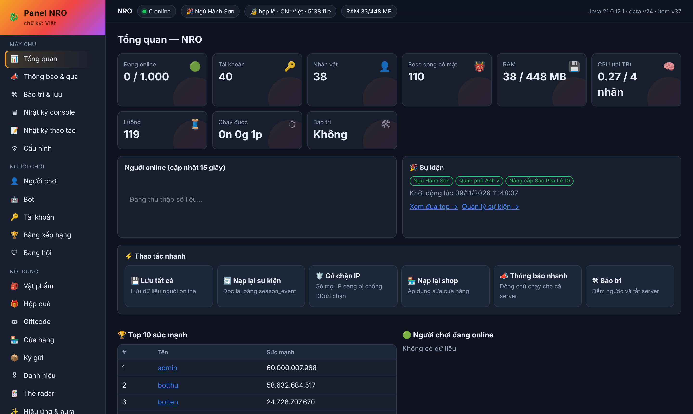
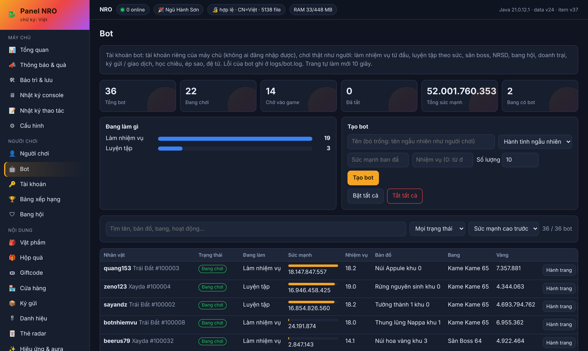

<div align="center">

# 🐉 NRO Dev AL

**Máy chủ game Ngọc Rồng Online viết bằng Java: kèm panel quản trị web, bot chơi như người thật và hệ thống sự kiện theo mùa.**


[Tính năng](#-tính-năng) · [Ảnh chụp](#-ảnh-chụp) · [Cài đặt](#-cài-đặt-nhanh) · [Cấu hình](#️-cấu-hình) · [Cấu trúc](#-cấu-trúc-thư-mục) · [Tài liệu](#-tài-liệu)

</div>

---

## ✨ Tính năng

<table>
<tr>
<td width="50%" valign="top">

### 🎮 Lối chơi
- Nhiệm vụ chính đầy đủ, gồm chuỗi Bardock
- Boss theo giờ, boss sự kiện, Hirudegarn, Broly (15 tỷ HP)
- Doanh trại, Ngọc Rồng Sao Đen, Đại hội võ thuật, Siêu hạng
- Set kích hoạt, sao pha lê, bông tai cấp 2/3, đệ tử 2
- Chỉ số chiến đấu và tiền tệ dùng `long`: sát thương vượt 2,1 tỷ

</td>
<td width="50%" valign="top">

### 🤖 Bot như người thật
- Tài khoản bot riêng, không ai đăng nhập được
- Làm nhiệm vụ từ đầu, luyện tập theo sức, săn boss, NRSD
- Lập và vào bang hội, đi doanh trại, ký gửi, giao dịch
- Học chiêu, ép sao theo lối chơi, tự rút kinh nghiệm chọn map
- Chơi theo ca (online / offline), trả lời khi người chơi gọi tên

</td>
</tr>
<tr>
<td valign="top">

### 🎉 Sự kiện theo mùa
- Bật / tắt sự kiện tùy ý hoặc chạy theo lịch
- Shop sự kiện, đổi điểm, đua top có thưởng
- Thông báo top 1 - 10 khi đăng nhập
- Chợ ký gửi đồ sự kiện riêng (NPC King Furry)

</td>
<td valign="top">

### 🛡️ Vận hành
- Mạng Netty, chống DDoS và giới hạn kết nối mỗi IP
- Panel web quản trị (không cần cài thêm)
- Chạy được trên VPS 1 - 2 GB RAM
- Tự nâng cấp cơ sở dữ liệu khi khởi động (migration)

</td>
</tr>
</table>

## 📸 Ảnh chụp

<div align="center">

**Panel: tổng quan máy chủ**



**Panel: quản lý bot**



</div>

## 🚀 Cài đặt nhanh

**Yêu cầu:** JDK 21 LTS (không dùng JDK 23 trở lên vì Lombok chưa hỗ trợ) và MySQL 5.7 / 8.0.

```bash
# 1. Lấy mã nguồn
git clone https://github.com/Eng77-gif/nro_dev_al.git
cd nro_dev_al

# 2. Tạo cơ sở dữ liệu và nạp dữ liệu mẫu
mysql -u root -p -e "CREATE DATABASE team2026 CHARACTER SET utf8mb4"
mysql -u root -p team2026 < sql/team2026.sql

# 3. Sửa Config.properties (tài khoản MySQL, IP, mật khẩu panel)

# 4. Chạy máy chủ
./run_vps_yeu.sh        # Linux, VPS yếu
run_vps_yeu.bat         # Windows, VPS yếu
run.bat                 # Windows, máy mạnh
```

Máy chủ game nghe ở cổng `14445`, panel ở `http://<ip>:8088/`. Các bảng mới được tạo tự động ở lần chạy đầu.

**Build từ mã nguồn:** mở thư mục bằng Apache NetBeans 21 trở lên (đã có sẵn `nbproject`) rồi chọn *Clean and Build*, hoặc dùng `20.jar` có sẵn.

## ⚙️ Cấu hình

Mọi cấu hình nằm trong `Config.properties`:

| Khóa | Ý nghĩa |
|---|---|
| `server.port` | Cổng máy chủ game (mặc định `14445`) |
| `server.maxplayer` / `server.maxperip` | Giới hạn người chơi và số kết nối mỗi IP |
| `server.expserver` | Hệ số kinh nghiệm |
| `database.*` | Kết nối MySQL |
| `panel.enable` / `panel.port` / `panel.user` / `panel.pass` | Panel web |

> [!IMPORTANT]
> Hãy đặt `panel.pass` mạnh trước khi mở cổng panel ra Internet. Tốt nhất chỉ mở cổng `8088` cho IP của bạn.

## 📁 Cấu trúc thư mục

```
nro_dev_al/
├── src/nro/models/
│   ├── Bot/          # bot: nhiệm vụ, bang hội, buôn bán, tự học chọn map
│   ├── boss/         # các boss và dữ liệu boss
│   ├── database/     # truy cập dữ liệu và migration theo đợt
│   ├── network/      # giao thức, Netty, chống DDoS
│   ├── panel/        # API của panel web
│   ├── services/     # logic game: kỹ năng, sự kiện, cửa hàng...
│   └── ...
├── data/             # tài nguyên game và giao diện panel (data/panel)
├── sql/              # dữ liệu mẫu
├── tools/            # công cụ tài nguyên, client, bản tự kiểm tra
└── docs/images/      # ảnh dùng trong README
```

## 📚 Tài liệu

| Tài liệu | Nội dung |
|---|---|
| [HUONG_DAN_PANEL.md](HUONG_DAN_PANEL.md) | Cấu hình và các mục của panel web |
| [HUONG_DAN_VPS_YEU.md](HUONG_DAN_VPS_YEU.md) | Chọn JDK / NetBeans, chạy trên VPS ít RAM |
| [BUGFIXES.md](BUGFIXES.md) | Nhật ký thay đổi và sửa lỗi theo từng đợt |
| `Lệnh admin.docx` | Danh sách lệnh admin trong game |

## 🧪 Kiểm tra

```bash
bash tools/tests/run.sh   # biên dịch máy chủ và chạy các bản tự kiểm tra (*Check.java)
```

---

<div align="center">

Phát triển bởi **Việt** · Dự án phi lợi nhuận, phục vụ học tập và nghiên cứu.<br>
Ngọc Rồng Online và Dragon Ball là thương hiệu của chủ sở hữu tương ứng.

</div>
